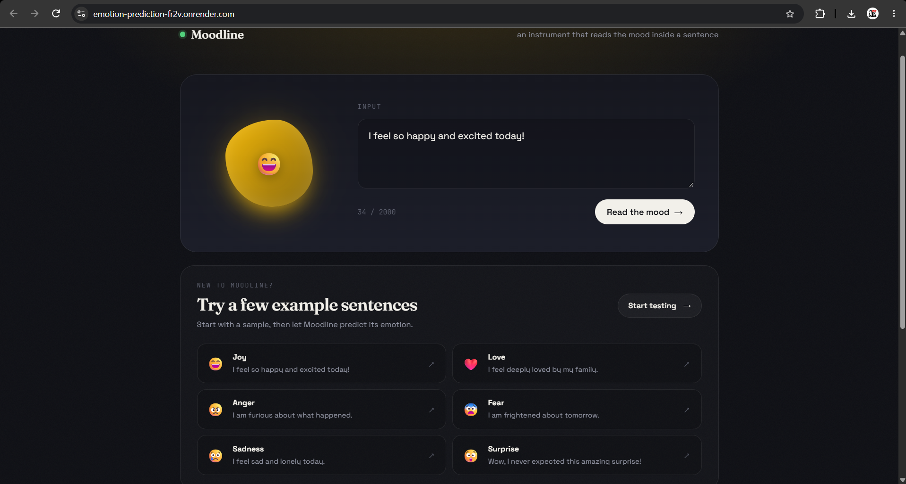

<div align="center">

# MOODLINE
### Read the emotion. Understand the moment.

A text emotion-prediction web app powered by a BiGRU deep-learning model.

<p>
  <a href="https://emotion-prediction-fr2v.onrender.com/"><strong>🌐 Live Demo</strong></a>
  &nbsp; • &nbsp;
  <a href="https://github.com/Aditya-Kurlekar/Emotion-Prediction"><strong>💻 Source Code</strong></a>
</p>

</div>

---

## ✨ Preview

<p align="center">
  <a href="https://emotion-prediction-fr2v.onrender.com/">
    
  </a>
</p>

<p align="center">
  <em>Click the preview to open the live application.</em>
</p>

> **Preview image note:** Add a screenshot of the deployed website to `static/preview.png` in this repository. Until that image exists, the preview above will not render. You can instead upload the screenshot to GitHub and replace the image URL with its actual URL.

## 🖤 About Moodline

Moodline is a minimal, dark-themed web application that predicts the emotion expressed in a piece of text. Enter a sentence and let the model estimate the emotion behind it through a simple, interactive interface.

The experience features an emotion-reactive orb, animated result presentation, and example sentences to help you explore the model.

## 🎭 Supported emotions

| Emotion | Example |
|---|---|
| 😊 Joy | “I feel so happy and excited today!” |
| 💗 Love | “I feel deeply loved by my family.” |
| 😠 Anger | “I am furious about what happened.” |
| 😨 Fear | “I am frightened about tomorrow.” |
| 😢 Sadness | “I feel lonely and sad today.” |
| 😲 Surprise | “I never expected this amazing news!” |

## 🚀 Features

- **Six emotion classes** — Joy, Love, Anger, Fear, Sadness, and Surprise.
- **BiGRU model** — text classification using a Bidirectional Gated Recurrent Unit network.
- **FastAPI backend** — serves the prediction API and the frontend.
- **Interactive interface** — emotion-reactive orb, smooth result animations, and sample sentence cards.
- **Responsive styling** — a premium, minimal dark interface with warm accent details.
- **Live deployment** — hosted on Render.

## 🧰 Tech stack

| Layer | Technologies |
|---|---|
| Machine learning | TensorFlow / Keras, BiGRU |
| API | FastAPI, Pydantic, Uvicorn |
| Data processing | NumPy, tokenizer and sequence padding |
| Frontend | HTML, CSS, JavaScript |
| Deployment | Render |
| Version control | Git, GitHub |

## 🗂️ Project structure

```text
Emotion-Prediction/
├── Artifacts/
│   ├── BiGRU_Modle.keras
│   └── tokenizer.pkl
├── static/
│   ├── index.html
│   ├── script.js
│   ├── style.css
│   └── preview.png          # Add your website screenshot here
├── main.py
├── requirements.txt
├── runtime.txt
├── .python-version
├── .gitignore
└── DL.ipynb
```

## ⚙️ Run locally

### 1. Clone the repository

```bash
git clone https://github.com/Aditya-Kurlekar/Emotion-Prediction.git
cd Emotion-Prediction
```

### 2. Create and activate a virtual environment

**Windows PowerShell**
```powershell
python -m venv .venv
.\.venv\Scripts\Activate.ps1
```

**macOS / Linux**
```bash
python3 -m venv .venv
source .venv/bin/activate
```

### 3. Install dependencies

```bash
pip install -r requirements.txt
```

### 4. Start the application

```bash
uvicorn main:app --reload
```

Open `http://127.0.0.1:8000` in your browser.

Interactive API documentation is available at `http://127.0.0.1:8000/docs`.

## 🔌 API

### `GET /health`

Use this endpoint to check whether the service is responding.

### `POST /predict`

Submit text for emotion prediction.

Example request body:

```json
{
  "text": "I feel so happy and excited today!"
}
```

See `/docs` on the running application for the exact request schema and response format.

## 🌍 Links

- **Live application:** https://emotion-prediction-fr2v.onrender.com/
- **GitHub repository:** https://github.com/Aditya-Kurlekar/Emotion-Prediction
- **API documentation:** https://emotion-prediction-fr2v.onrender.com/docs
- **Health check:** https://emotion-prediction-fr2v.onrender.com/health

## 🧠 Model notes

Moodline uses a trained BiGRU model and a saved tokenizer to convert input text into a predicted emotion category. Predictions are model estimates and can be affected by wording, context, sarcasm, spelling, and ambiguity. The output should not be treated as a definitive assessment of a person's emotional state.

## 👤 Author

**Aditya Kurlekar**

- GitHub: [@Aditya-Kurlekar](https://github.com/Aditya-Kurlekar)

---

<div align="center">

**MOODLINE** · A deep-learning project exploring emotion classification from text.

<sub>Built with Python, TensorFlow, FastAPI, HTML, CSS, and JavaScript.</sub>

</div>
